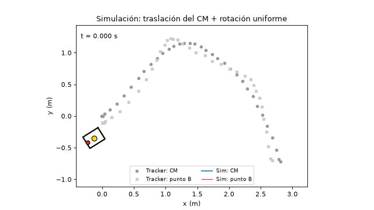
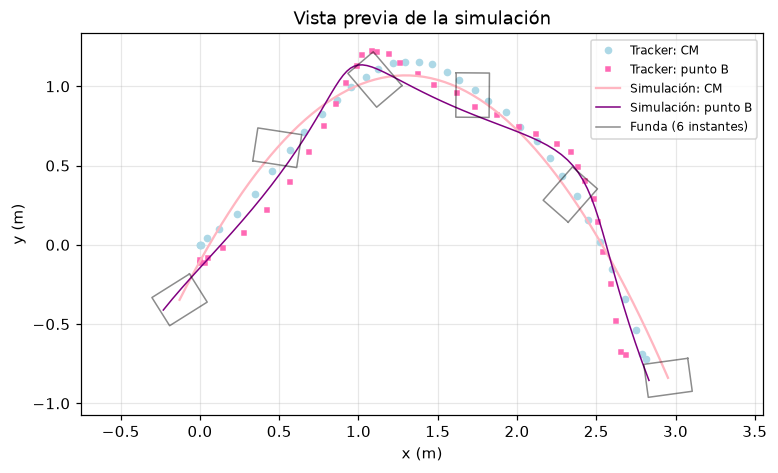
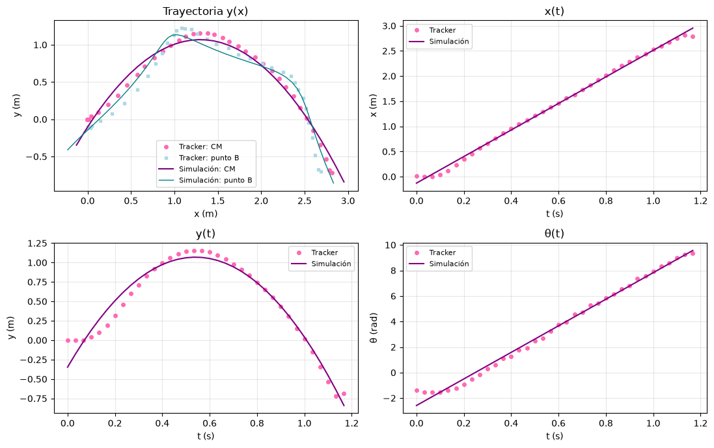
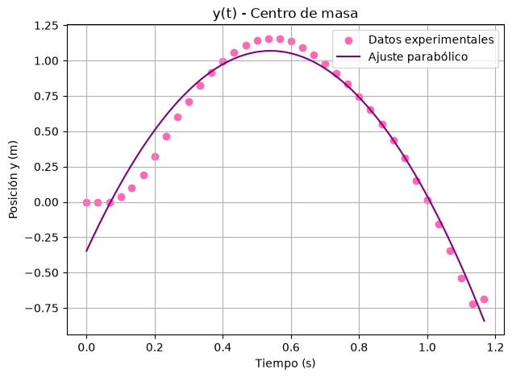
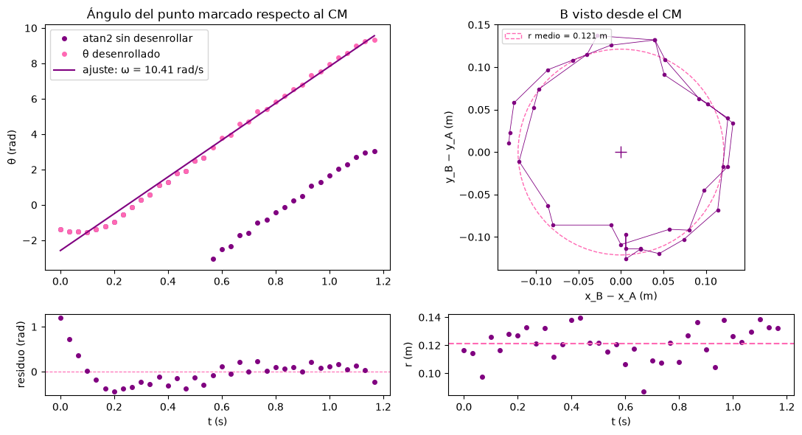
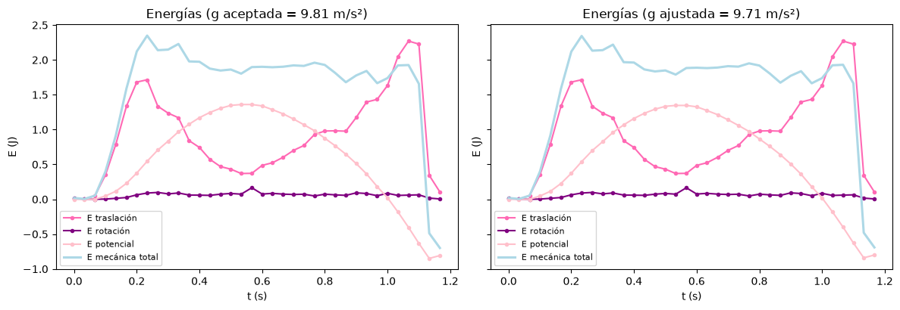

# Proyecto de Mecánica — Análisis y simulación de un movimiento compuesto

**Universidad Industrial de Santander · Mecánica · II Semestre 2026**
**Docente:** Adriana Lucía Gélvez Cortés

**Integrantes:**

| Nombre | Código |
|---|---|
| María Alejandra Díaz | 2260822 |
| Daniel Alvarado Galvis | 2260803 |
| Santiago Aguilar Vesga | 2260830 |

**Objeto lanzado:** funda rectangular de iPad, masa **120 g**, cara visible de **28 cm × 21 cm** (espesor ≈ 2 cm).



---

## Índice

1. [Contenido de la entrega](#1-contenido-de-la-entrega)
2. [Cómo ejecutar el notebook en VS Code (recomendado)](#2-cómo-ejecutar-el-notebook-en-vs-code-recomendado)
3. [Alternativa: Jupyter desde la terminal](#3-alternativa-jupyter-desde-la-terminal)
4. [Por qué puede fallar en Jupyter online](#4-por-qué-puede-fallar-en-jupyter-online)
5. [Cómo usar el simulador](#5-cómo-usar-el-simulador)
6. [Estructura del notebook y correspondencia con el enunciado](#6-estructura-del-notebook-y-correspondencia-con-el-enunciado)
7. [Resultados principales](#7-resultados-principales)
8. [Solución de problemas](#8-solución-de-problemas)

---

## 1. Contenido de la entrega

```
proyecto mecanica/
├── probar.ipynb                   ← Notebook con análisis, informe y simulación (Entrega 2)
├── datos_movimiento_tracker.csv   ← Datos exportados de Tracker: t, x, y de ambos puntos, en m y s
├── tracker con video 2.trk        ← Archivo de Tracker calibrado, con los dos puntos rastreados
├── video original.mp4             ← Video original, sin editar
├── video 2 (invertido).mp4        ← Video espejado (el que se analizó en Tracker)
├── imagenes/
│   ├── captura1.png               ← Capturas de Tracker (metodología)
│   ├── captura2.png
│   ├── dcl.jpeg                   ← Diagrama de cuerpo libre
│   └── readme/                    ← Imágenes usadas solo en este README
├── requirements.txt               ← Librerías de Python necesarias
└── README.md
```

> **Importante:** el notebook lee `datos_movimiento_tracker.csv` y las imágenes de la carpeta `imagenes/` con
> **rutas relativas**. Hay que abrir el notebook **desde la carpeta del proyecto** y mantener esta estructura.
> Si se mueve solo el `.ipynb`, las celdas fallan con `FileNotFoundError`.

**Columnas del CSV:**

| Columna | Significado | Unidad |
|---|---|---|
| `t_s` | tiempo | s |
| `xA_m`, `yA_m` | posición del **centro de masa** (punto A) | m |
| `xB_m`, `yB_m` | posición del **punto marcado** en el extremo (punto B) | m |

---

## 2. Cómo ejecutar el notebook en VS Code (recomendado)

### 2.1 Requisitos

| Programa | Dónde se consigue |
|---|---|
| **Python 3.10 o superior** | <https://www.python.org/downloads/> (en Windows, marcar **"Add python.exe to PATH"** al instalar) |
| **Visual Studio Code** | <https://code.visualstudio.com/> |
| Extensión **Python** (Microsoft) | Pestaña de extensiones de VS Code (`Ctrl+Shift+X`), buscar `ms-python.python` |
| Extensión **Jupyter** (Microsoft) | Pestaña de extensiones de VS Code, buscar `ms-toolsai.jupyter` |

Para comprobar que Python quedó instalado, abra una terminal y escriba:

```bash
python --version
```

(En macOS o Linux puede ser `python3 --version`.)

### 2.2 Abrir la carpeta del proyecto

1. Descomprima la entrega si viene en `.zip`.
2. En VS Code: **Archivo → Abrir carpeta…** (`File → Open Folder…`) y seleccione la carpeta `proyecto mecanica`
   (la que contiene `probar.ipynb` y `datos_movimiento_tracker.csv`).
3. Si VS Code pregunta *"¿Confía en los autores de los archivos de esta carpeta?"*, elija **Sí, confío**.
   Si no, el notebook se abre en modo restringido y no se puede ejecutar.

> Abra la **carpeta**, no solo el archivo `.ipynb`. Así el directorio de trabajo es el correcto y las rutas
> relativas a `datos_movimiento_tracker.csv` e `imagenes/` funcionan.

### 2.3 Crear un entorno virtual e instalar las librerías

Abra la terminal integrada: **Terminal → Nueva terminal** (`` Ctrl+` ``). Ya queda ubicada en la carpeta del proyecto.

**Windows (PowerShell):**

```powershell
python -m venv .venv
.\.venv\Scripts\Activate.ps1
python -m pip install --upgrade pip
pip install -r requirements.txt
```

> Si PowerShell muestra *"la ejecución de scripts está deshabilitada en este sistema"*, ejecute una vez
> `Set-ExecutionPolicy -Scope CurrentUser RemoteSigned` y repita la activación.
> También puede usar `cmd` y activar con `.venv\Scripts\activate.bat`.

**macOS / Linux:**

```bash
python3 -m venv .venv
source .venv/bin/activate
python -m pip install --upgrade pip
pip install -r requirements.txt
```

`requirements.txt` instala:

| Librería | Uso en el notebook |
|---|---|
| `numpy` | ajustes por mínimos cuadrados (`polyfit`), `unwrap`, derivadas numéricas |
| `pandas` | lectura del CSV y tablas de resultados |
| `matplotlib` | gráficas y animación (`FuncAnimation`) |
| `pillow` | guarda la animación como GIF (`PillowWriter`) |
| `ipykernel` | permite que VS Code ejecute el notebook con este entorno |
| `ipywidgets` | controles deslizantes del simulador interactivo |

> **¿Sin entorno virtual?** También funciona instalar todo directamente con
> `pip install numpy pandas matplotlib pillow ipykernel ipywidgets` y elegir esa instalación de Python como kernel.

### 2.4 Seleccionar el kernel

1. Abra `probar.ipynb` desde el explorador de archivos de VS Code.
2. Arriba a la derecha haga clic en **Seleccionar kernel** (`Select Kernel`).
3. Elija **Entornos de Python…** (`Python Environments…`) y luego **`.venv`** (el entorno que acaba de crear).

Si `.venv` no aparece, cierre y vuelva a abrir VS Code, o use `Ctrl+Shift+P` → **Python: Select Interpreter** →
`.venv`.

### 2.5 Ejecutar todo

1. Haga clic en **Ejecutar todo** (`Run All`) en la barra superior del notebook.
2. La ejecución completa tarda **alrededor de 30–60 segundos**. Las celdas más lentas son:
   - **2.5 Incertidumbre:** simulación de Monte Carlo con 3000 repeticiones.
   - **Simulación:** genera la animación GIF cuadro a cuadro.
3. Al terminar, todas las celdas deben mostrar un ✔ verde y ninguna debe mostrar error.

Se verificó que el notebook corre **de principio a fin sin errores** en un entorno limpio con Python 3.12 y las librerías de `requirements.txt`.

> Si antes se ejecutaron celdas sueltas o en desorden, use **Reiniciar** (`Restart`) y luego **Ejecutar todo**,
> para que el resultado no dependa de variables viejas en memoria.

---

## 3. Alternativa: Jupyter desde la terminal

Si prefiere no usar VS Code, con el mismo entorno virtual activado:

```bash
pip install notebook
jupyter notebook probar.ipynb
```

Se abre en el navegador. Use **Kernel → Restart & Run All** (o **Run → Run All Cells** en JupyterLab).

---

## 4. Por qué puede fallar en Jupyter online

En servicios como **JupyterLite** (la opción "Try Jupyter" de jupyter.org), Binder o Colab, el notebook puede
fallar por motivos que no ocurren en una ejecución local:

| Síntoma | Causa | Qué hacer |
|---|---|---|
| `FileNotFoundError: datos_movimiento_tracker.csv` o `imagenes/...` | Solo se subió el `.ipynb`. El CSV y la carpeta `imagenes/` no están junto a él. | Subir **toda** la carpeta con la misma estructura, o ejecutarlo localmente (sección 2). |
| `ModuleNotFoundError: ipywidgets` o los deslizadores no aparecen | El servicio no trae `ipywidgets`, o no tiene habilitada la extensión que dibuja los controles. | Ejecutarlo localmente. La simulación también se puede controlar cambiando las variables de la celda `X0_SIM`, `V0_SIM`, etc. |
| La animación no se genera o tarda demasiado | JupyterLite corre Python **dentro del navegador** (Pyodide). Es mucho más lento y algunas funciones de archivos temporales y escritores de animación no se comportan igual. | Ejecutarlo localmente. |
| Aparece `Widget Javascript not detected` o *"Error displaying widget"* | Los widgets solo funcionan con un kernel activo. Las salidas guardadas no los incluyen. | Ejecutar la celda del simulador con el kernel activo. |

**Por eso recomendamos ejecutarlo en VS Code.** Además, el notebook se entrega **con todas las salidas ya
guardadas**: aunque no se ejecute, al abrirlo en VS Code (o incluso en GitHub) se ven todas las gráficas,
tablas y la animación.

---

## 5. Cómo usar el simulador

La sección **Simulación** del notebook tiene tres formas de cambiar las condiciones iniciales.

### 5.1 Variables al inicio de la simulación

En la celda que empieza con `X0_SIM = x0` se pueden reemplazar los valores ajustados por valores propios:

```python
X0_SIM = x0          # posición inicial x del CM (m)        ← ajuste lineal de x(t), sección 2.2
Y0_SIM = y0          # posición inicial y del CM (m)        ← ajuste parabólico de y(t), sección 2.2
V0_SIM = v0          # rapidez de lanzamiento (m/s)         ← √(v0x² + v0y²) de los ajustes
ANG_SIM = ang0       # ángulo de lanzamiento (°)            ← atan2(v0y, v0x)
OMEGA_SIM = omega    # velocidad angular (rad/s)            ← pendiente del ajuste de θ(t), sección 2.3
THETA0_SIM = theta0  # ángulo inicial (rad)                 ← intercepto del ajuste de θ(t)
G_SIM = g_fit        # gravedad (m/s²): g_fit o G_ACEPTADA (9.81)
R_SIM = r_med        # distancia CM → punto marcado (m)
T_SIM = t[-1]        # duración de la simulación (s)
```

Por ejemplo, `V0_SIM = 6.0` y `ANG_SIM = 45`. Después se ejecutan esa celda y las siguientes.

### 5.2 Simulador interactivo (ipywidgets)

Con el kernel activo, la celda **SIMULADOR INTERACTIVO** muestra deslizadores para x₀, y₀, v₀, ángulo de lanzamiento, ω, θ₀ y duración, más un menú para elegir *g* ajustada o aceptada:

- Al mover un deslizador se actualizan la **vista previa** (trayectorias y la funda en 6 instantes) y los
  resultados teóricos (v₀ₓ, v₀ᵧ, altura máxima, alcance, número de vueltas y RMSE frente a Tracker).
- **▶ Animar** genera la animación con las condiciones elegidas.
- **↺ Experimento** devuelve todos los controles a las condiciones del experimento.
- **Superponer datos de Tracker** muestra u oculta los puntos medidos.

Vista previa con las condiciones del experimento:



### 5.3 Comparación con Tracker

Con las condiciones del experimento, la predicción se evalúa en los mismos instantes de Tracker y se reporta el
**RMSE** en x, y y θ (todas las filas, solo vuelo libre y parámetros reajustados al vuelo libre):



---

## 6. Estructura del notebook y correspondencia con el enunciado

| # | Sección del enunciado | Dónde está en `probar.ipynb` |
|---|---|---|
| 1 | Encabezado: integrantes, objeto, forma, masa, dimensiones | Primera celda |
| 2 | Metodología: grabación, calibración y rastreo en Tracker, con capturas | "Metodología" + `captura1.png`, `captura2.png` |
| 3 | Datos: tablas y gráficas | "Datos" (tabla completa del CSV y constantes del objeto y de la calibración) |
| 4 | **2.1** DCL, equilibrio y torque respecto al CM | "2.1" + `dcl.jpeg` |
| 4 | **2.2** y(x), x(t), y(t) de ambos puntos; ajustes con incertidumbre; g frente a 9,81; v₀ₓ, v₀ᵧ, rapidez, ángulo, altura máxima, alcance | "2.2" |
| 4 | **2.3** Posición relativa (transformación galileana), θ(t) desenrollado, ω por mínimos cuadrados, residuos, v_rel = ωr | "2.3" |
| 4 | **2.4** E_tras, E_rot, E_p y E total contra t; I = m(a²+b²)/12 citado; momento horizontal | "2.4" |
| 4 | **2.5** Incertidumbre (escala, marcado por Monte Carlo, ventana de datos) y discusión de errores | "2.5" |
| 5 | **Parte 3** Simulación: condiciones iniciales editables, animación con forma, CM, punto marcado y trayectoria, superposición con Tracker y RMSE | "Simulación" |
| 6 | **2.6** Respuestas a las 5 preguntas | "Respuesta sección 2.6" |
| 7 | Conclusiones | "Conclusiones" |
| 8 | Contribución de cada integrante | "Contribución de cada integrante" |
| 9 | Fuentes (incluye la declaración del uso de IA) | "Fuentes consultadas" |

**Modelo de la simulación** (aceleración constante del Centro de Masa + rotación uniforme):

$$x(t) = x_0 + v_0\cos\phi\,t,\qquad y(t) = y_0 + v_0\sin\phi\,t - \tfrac12 g t^2,\qquad \theta(t) = \theta_0 + \omega t$$

$$\vec r_B(t) = \vec r_{cm}(t) + r\,(\cos\theta,\ \sin\theta)$$

Todos los parámetros salen de los ajustes del grupo (secciones 2.2 y 2.3) y de las medidas del objeto. No se usan valores genéricos.

---

## 7. Resultados principales

| Magnitud | Valor |
|---|---|
| g (ajuste de las 36 filas) | **9,71 ± 0,35 m/s²** (0,97 % del valor aceptado) |
| g (solo vuelo libre, filas 6–33) | 11,64 ± 0,18 m/s² (probable error de escala por perspectiva, ver 2.5) |
| v₀ₓ | 2,64 ± 0,03 m/s |
| ω | 10,41 ± 0,17 rad/s (11,04 ± 0,08 rad/s en vuelo libre) |
| v_rel medida frente a ωr | 1,17 ± 0,36 m/s frente a 1,26 ± 0,13 m/s (compatibles) |
| I_cm = m(a²+b²)/12 | 1,225 × 10⁻³ kg·m² |
| E_rot / E_tras en vuelo libre | ≈ 7 % |
| RMSE simulación frente a Tracker | 52 mm en x, 105 mm en y |

<p align="center">
  
  
</p>



---

## 8. Solución de problemas

| Problema | Solución |
|---|---|
| `ModuleNotFoundError: No module named 'pandas'` (u otra librería) | El kernel elegido no es el `.venv`. Vuelva a la sección 2.4, o ejecute `pip install -r requirements.txt` con el entorno activado. |
| VS Code pide instalar `ipykernel` | Acepte, o ejecute `pip install ipykernel` en el entorno. |
| `FileNotFoundError` al leer el CSV o las imágenes | Abra la **carpeta** del proyecto en VS Code (sección 2.2), no el archivo suelto. Verifique que `datos_movimiento_tracker.csv` e `imagenes/` estén junto al notebook. |
| No aparecen los deslizadores | Verifique que `ipywidgets` esté instalado en el kernel activo y que la extensión **Jupyter** de VS Code esté actualizada. Reinicie el kernel. |
| La animación tarda | Es normal: se generan unos 35 cuadros y se guardan como GIF. Espere a que termine la celda. |
| `UserWarning: color is redundantly defined…` en la sección 2.4 | Es solo una advertencia de estilo de matplotlib. No afecta los resultados. |
| Resultados raros después de ejecutar celdas sueltas | **Reiniciar → Ejecutar todo**. |

---

## Archivos de Tracker

Para revisar el rastreo, abra `tracker con video 2.trk` con **Tracker** (<https://physlets.org/tracker/>). El
`.trk` usa el video `video 2 (invertido).mp4`. Si Tracker no lo encuentra, indíquele ese archivo, que está en la misma carpeta. El
video se espejó para que el movimiento quedara hacia +x. El original sin editar es `video original.mp4`.
